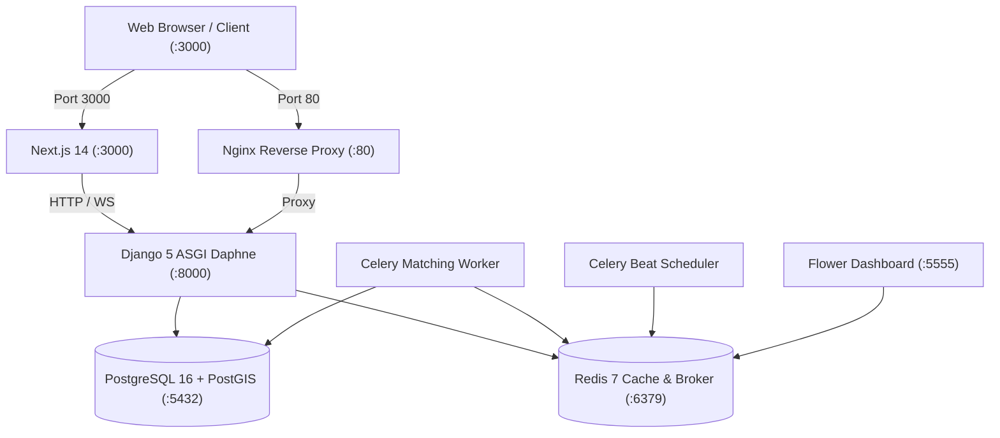

# Eworks (HomeWorks) — Engineering Handover & Developer Guide

Welcome to the **Eworks** engineering repository! This document provides a complete technical handover, architecture breakdown, setup instructions, and roadmap for the incoming engineering team.

---

## 1. Executive Summary & Tech Stack

**Eworks** is a real-time, hyperlocal on-demand home services marketplace inspired by the **Rapido / Uber instant matching model**.

### Core Technology Stack

| Layer | Technology | Details |
|---|---|---|
| **Frontend** | **Next.js 14** (App Router) + TypeScript + Tailwind CSS | React 18, Zustand, Lucide Icons, Hot Toast, Glassmorphism UI |
| **Backend API** | **Django 5.0** + Django REST Framework | Python 3.12, ASGI / Daphne, Django Channels 4.1 |
| **Spatial Database** | **PostgreSQL 16** + **PostGIS 3.4** | Spatial indexing (`ST_DWithin`, `ST_DistanceSphere`, `PointField`) |
| **Real-time & Broker** | **Redis 7** | WebSocket Channel Layer, Pub/Sub, Caching, Celery Broker |
| **Task Queue** | **Celery 5.4** + **Celery Beat** | Asynchronous dispatch engine, batch offer expirations, periodic cleanup |
| **Monitoring** | **Flower** | Celery queue and worker health monitoring dashboard |
| **Reverse Proxy** | **Nginx 1.25** | Static/media serving, SSL termination, API routing, rate limiting |
| **Containerization** | **Docker & Docker Compose** | Fully reproducible 8-container local and production environment |

---

## 2. Docker Architecture & Port Mapping

When running via Docker, 8 containers operate together in an isolated network:



| Container | Service | Host Port | Role |
|---|---|---|---|
| `hsm_frontend` | Next.js 14 Web App | `3000` | Customer portal, Partner portal, Admin dashboard |
| `hsm_backend` | Django ASGI / Daphne | `8000` | REST API, WebSockets (`/ws/dispatch/`, `/ws/tracking/`), Auth |
| `hsm_db` | PostgreSQL / PostGIS | `5432` | Geo-spatial database, users, bookings, audit |
| `hsm_redis` | Redis 7 | `6379` | WebSocket channels, worker queue, cache |
| `hsm_celery_worker` | Celery Worker | - | Dispatch matching engine, notifications, auto-cancellation |
| `hsm_celery_beat` | Celery Beat | - | Periodic task scheduler (10-second dispatch sweeps) |
| `hsm_flower` | Celery Flower | `5555` | Task queue inspection & health metrics |
| `hsm_nginx` | Nginx Proxy | `80` | Reverse proxy and production routing |

---

## 3. Quick Start (Get Running in 3 Steps)

### Step 1: Clone & Configure Environment
```bash
git clone <repository_url>
cd Eworks

# Copy the example environment file
cp .env.example .env
```

### Step 2: Boot All Microservices
```bash
docker compose up -d --build
```
*Wait 20-30 seconds for PostgreSQL and migrations to complete.*

### Step 3: Seed Initial Platform Data
```bash
docker compose exec backend python manage.py seed_data
```
This automatically sets up categories, test customers, verified service partners, and an admin user.

---

## 4. Default Credentials & Access URLs

| Application / Portal | URL | Credentials |
|---|---|---|
| **Customer Web** | [http://localhost:3000](http://localhost:3000) | `customer@eworks.com` / `Customer@123` |
| **Partner Portal** | [http://localhost:3000/dashboard/partner](http://localhost:3000/dashboard/partner) | `partner@eworks.com` / `Partner@123`<br/>*or* `balajishankarganesh01@gmail.com` |
| **Admin Dashboard** | [http://localhost:3000/dashboard/admin](http://localhost:3000/dashboard/admin) | `admin@eworks.com` / `Admin@123` |
| **Django Admin** | [http://localhost:8000/django-admin/](http://localhost:8000/django-admin/) | `admin@eworks.com` / `Admin@123` |
| **API Documentation (Swagger)** | [http://localhost:8000/api/v1/docs/](http://localhost:8000/api/v1/docs/) | Open access (Interactive Swagger) |
| **Celery Flower Dashboard** | [http://localhost:5555](http://localhost:5555) | Open access |

---

## 5. Core Architectural Workflows

### A. The Hyperlocal Dispatch Engine (Rapido-Style)
1. **Customer Request**: Customer creates an `INSTANT` booking with their GPS coordinates (`POST /api/v1/bookings/`).
2. **Batch Candidate Discovery**:
   - `backend/apps/matching/services.py` queries active, online partners within a 15 km radius.
   - Filters partners by service category, weekly schedule, and current active job status.
   - Calculates a **Composite Score**: `50% Proximity + 30% Average Rating + 20% Job Experience`.
3. **Batch Dispatch**:
   - Dispatches offer to Top 3 partners simultaneously via WebSocket (`/ws/dispatch/partner/`).
   - Offers have a 45-second countdown timer.
4. **First-to-Accept Lock**:
   - Uses Redis atomic distributed lock (`redis.lock(f"booking_claim_{booking_id}")`).
   - The first partner to click "Accept" claims the job; competing offers are immediately revoked.
5. **Batch Escalation**:
   - If the first batch expires without acceptance, Celery Beat escalates to the next batch with a wider radius (+5 km).

### B. Live Partner GPS & Online Status
- Partners toggle online/offline at `PUT/POST /api/v1/accounts/me/toggle-online/`.
- While online, the partner app emits live coordinates every 10-15s via `POST /api/v1/locations/partner/update-location/`.
- Updates `PartnerLocation` spatial point in PostGIS.

### C. OTP Security & Job Verification
- When partner arrives at customer location:
  1. A 4-digit start OTP is verified via `POST /api/v1/bookings/{id}/verify-otp/`.
  2. Booking status transitions to `IN_PROGRESS`.
  3. When job is done, partner marks complete; customer receives settlement bill.

### D. Tamil Nadu State-wide Coverage (All 38 Districts)
- [`backend/apps/locations/views.py`](backend/apps/locations/views.py):
  - Service coverage is configured with bounding box `8.0°N – 13.6°N` and `76.1°E – 80.5°E`.
  - District hubs: Chennai, Coimbatore, Madurai, Tiruchirappalli, Salem, Tiruppur, Erode, Tirunelveli, Vellore, Thanjavur, Thoothukudi, Dindigul, Kanyakumari, etc.
  - Endpoint `GET /api/v1/locations/districts/` provides the list of all districts.

---

## 6. Repository Layout

```text
Eworks/
├── backend/                  # Django 5 ASGI application
│   ├── apps/
│   │   ├── accounts/         # Users, Customers, Partners, Auth, KYC
│   │   ├── bookings/         # Booking state machine, OTP, pricing
│   │   ├── matching/         # Hyperlocal scoring, batch dispatch, Celery tasks
│   │   ├── locations/        # PostGIS locations, geosearch, service areas
│   │   ├── services/         # Category catalog, pricing matrices
│   │   ├── payments/         # Payment models, escrow settlements, invoices
│   │   └── reviews/          # Partner rating & review system
│   ├── config/               # Django settings, ASGI routing, Celery config
│   ├── Dockerfile
│   └── requirements.txt
├── frontend/                 # Next.js 14 App Router application
│   ├── src/
│   │   ├── app/              # Routes: (auth), dashboard, services, bookings
│   │   ├── components/       # UI components (Navbar, Footer, AuthGuard, etc.)
│   │   ├── lib/              # Axios API client, websocket helpers
│   │   ├── store/            # Zustand global state (Auth, Active Booking)
│   │   └── types/            # TypeScript interfaces
│   ├── Dockerfile
│   └── package.json
├── infra/                    # Nginx configuration & SSL certificates
├── docker-compose.yml        # Development multi-container orchestration
├── docker-compose.prod.yml   # Production multi-container orchestration
└── .env.example              # Template environment variables
```

---

## 7. Recommended Next Steps for the Tech Team

1. **Payment Gateway Integration**:
   - Wire up **Razorpay** or **Cashfree** in `backend/apps/payments/` for UPI, Netbanking, and Cards.
   - Implement webhooks for payment capture and partner instant payouts.
2. **SMS & WhatsApp Gateway**:
   - Replace console OTP logging with **Twilio**, **Fast2SMS**, or **Gupshup** for live customer verification.
3. **Mobile Application (Optional/Recommended)**:
   - Build customer and partner mobile apps using React Native or Flutter, connecting to the existing `/api/v1/` endpoints and `/ws/` WebSockets.
4. **Production Deployment**:
   - Deploy on AWS ECS / DigitalOcean Droplet / Kubernetes using `docker-compose.prod.yml`.
   - Setup HTTPS certificates via Let's Encrypt / Certbot in Nginx.

