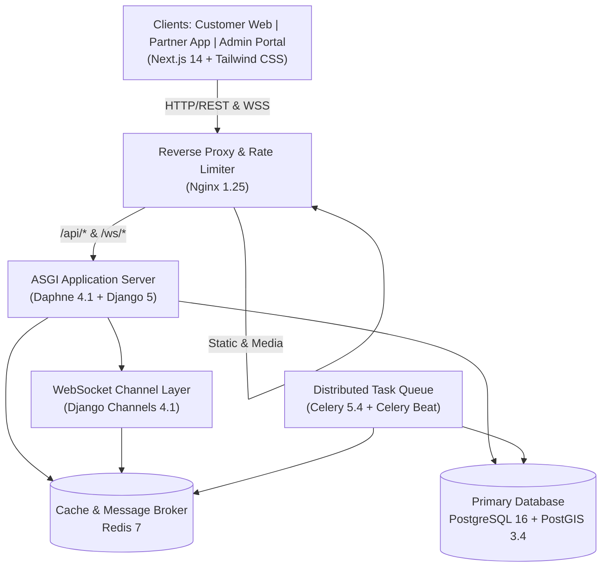

# HomeWorks — Real-Time Home Services Marketplace

A production-grade, full-stack home services marketplace inspired by Rapido's real-time matching model. Built with Next.js 14, Django 5, Django Channels, PostGIS 16, Redis 7, and Celery.

---

## Architecture Overview



---

## Quick Start (Docker)

### 1. Clone and Configure

```bash
git clone <repo-url> home-services-marketplace
cd home-services-marketplace
cp .env.example .env
# Edit .env with your secrets if needed
```

### 2. Start All Services

```bash
docker compose up --build
```

This launches:
- **db** — PostgreSQL 16 + PostGIS 3.4 on port 5432
- **redis** — Redis 7 on port 6379
- **backend** — Django / Daphne ASGI on port 8000
- **celery_worker** — Background worker for matching engine & notifications
- **celery_beat** — Periodic task scheduler for batch timeouts
- **flower** — Celery monitoring dashboard on port 5555
- **frontend** — Next.js 14 application on port 3000
- **nginx** — Reverse proxy on port 80

### 3. Create a Superuser

```bash
docker compose exec backend python manage.py createsuperuser
```

### 4. Access the Applications

| App / Interface | URL | Description |
|-----------------|-----|-------------|
| **Customer Website** | http://localhost:3000 | Booking creation, service discovery, live tracking |
| **Partner Portal** | http://localhost:3000/dashboard/partner | Job radar, offer acceptance, earnings |
| **Admin Dashboard** | http://localhost:3000/dashboard/admin | Partner verification, dispute resolution, analytics |
| **Django Admin** | http://localhost/django-admin | Full relational & audit data admin |
| **Swagger UI** | http://localhost/api/v1/docs | Interactive OpenAPI documentation |
| **ReDoc** | http://localhost/api/v1/redoc | Clean API specification |
| **Celery Monitor (Flower)** | http://localhost:5555 | Task queues, active workers & performance |

---

## Local Development (Without Docker)

### Backend

```bash
cd backend

# Create virtualenv
python -m venv venv
.\venv\Scripts\activate    # Windows
source venv/bin/activate    # macOS / Linux

# Install dependencies
pip install -r requirements.txt

# Run migrations (PostGIS + Redis required)
python manage.py makemigrations
python manage.py migrate

# Run tests
pytest

# Start ASGI server
daphne -b 0.0.0.0 -p 8000 config.asgi:application

# In another terminal — start Celery worker
celery -A config.celery_app worker --loglevel=info -Q default,matching,notifications

# In another terminal — start Celery beat
celery -A config.celery_app beat --loglevel=info
```

### Frontend

```bash
cd frontend
npm install
npm run dev
# Running at http://localhost:3000
```

---

## Project Structure

```
home-services-marketplace/
├── frontend/                   # Next.js 14 — Customer, Partner, Admin sites
│   ├── src/
│   │   ├── app/
│   │   │   ├── (customer)/     # Customer booking flow
│   │   │   ├── (partner)/      # Partner portal
│   │   │   ├── (admin)/        # Admin dashboard
│   │   │   ├── bookings/       # Live booking tracking
│   │   │   ├── dashboard/      # Dashboards for all roles
│   │   │   └── services/       # Service catalog & category booking
│   │   ├── components/         # Shared UI (Navbar, Footer, AuthGuard, etc.)
│   │   ├── lib/                # API client, WebSocket hooks
│   │   ├── store/              # Zustand state management
│   │   └── types/              # TypeScript types
│   ├── Dockerfile
│   └── package.json
│
├── backend/
│   ├── config/                 # Django settings (base/dev/prod), ASGI, Celery
│   ├── apps/
│   │   ├── accounts/           # Users, CustomerProfile, PartnerProfile, KYC
│   │   ├── services/           # ServiceCategory, PartnerService
│   │   ├── locations/          # ServiceAddress, PartnerLocation (PostGIS), Availability
│   │   ├── bookings/           # Booking, BookingOffer, StatusHistory
│   │   ├── matching/           # Rapido-style Matching Engine (Celery tasks)
│   │   ├── notifications/      # Real-time WebSockets & In-App Alerts
│   │   ├── payments/           # Razorpay payment verification, Invoicing, Earnings
│   │   ├── reviews/            # Reviews, Star Ratings, Partner Replies
│   │   └── support/            # Support Tickets, Immutable Audit Logging, Middleware
│   ├── tests/                  # Pytest test suites across all 9 apps
│   ├── Dockerfile              # Multi-stage hardened non-root container
│   ├── manage.py
│   └── requirements.txt
│
├── infra/
│   ├── nginx/
│   │   ├── nginx.conf          # Reverse proxy, rate limiting, gzip
│   │   └── nginx.prod.conf     # Production SSL/TLS termination with HSTS
│   └── postgres/
│       └── init-postgis.sh     # PostGIS extension initialization
│
├── .github/workflows/
│   └── ci.yml                  # Linting, Pytest, Frontend check & Docker CI
├── docker-compose.yml          # Core container orchestration
├── docker-compose.prod.yml     # Production resource limits & overrides
├── .env.example
└── README.md
```

---

## API Overview

All REST endpoints are grouped under `/api/v1/`. Protected endpoints require standard JWT Bearer token authentication.

| App | Prefix | Key Endpoints | Description |
|-----|--------|---------------|-------------|
| **Auth** | `/api/v1/auth/` | `register/customer/`, `register/partner/`, `login/`, `token/refresh/`, `profile/` | Authentication & profile management |
| **Services** | `/api/v1/services/` | `categories/`, `categories/<slug>/`, `partner-services/` | Service catalog & partner capabilities |
| **Locations** | `/api/v1/locations/` | `addresses/`, `partner/location/`, `partner/availability/`, `geo-search/partners/`, `service-area-check/` | Saved addresses, GPS tracking, geo-search |
| **Bookings** | `/api/v1/bookings/` | `create/`, `list/`, `<id>/`, `<id>/cancel/`, `<id>/start/`, `<id>/complete/` | Full booking lifecycle & OTP verification |
| **Matching** | `/api/v1/matching/` | `trigger/`, `offers/`, `offers/<id>/accept/`, `offers/<id>/reject/` | Rapido-style matching & offer dispatch |
| **Notifications** | `/api/v1/notifications/` | `list/`, `<id>/read/`, `read-all/` | Push notifications & alert feeds |
| **Payments** | `/api/v1/payments/` | `orders/create/`, `verify/`, `earnings/`, `invoices/<booking_id>/` | Payment orders, verification & earnings ledger |
| **Reviews** | `/api/v1/reviews/` | `create/`, `partner/<id>/`, `<id>/reply/` | Ratings, reviews & partner replies |
| **Support** | `/api/v1/support/` | `tickets/`, `tickets/<id>/`, `admin/audit-logs/` | Customer support & audit logging |

Interactive documentation is available at `/api/v1/docs/` (Swagger UI).

---

## WebSocket Endpoints

| Protocol & Path | Authentication | Description |
|-----------------|----------------|-------------|
| `ws://host/ws/bookings/{booking_id}/` | JWT Token in Query / Header | Real-time booking tracking for customer & partner |
| `ws://host/ws/partner/stream/` | Partner JWT | Real-time broadcast radar for new booking offers |
| `ws://host/ws/notifications/` | Authenticated User JWT | Live notification alerts |

---

## Development Phases (All Complete)

| Phase | Status | Description |
|:-----:|:------:|-------------|
| **1** | ✅ Complete | Repository setup, Django 5, PostGIS 16, Redis 7, Celery 5, environment config |
| **2** | ✅ Complete | Custom User auth, customer/partner profiles, KYC document upload, service categories, admin verification |
| **3** | ✅ Complete | Booking lifecycle, scheduled slots, partner availability, PostGIS geo-radius search |
| **4** | ✅ Complete | Rapido-style matching engine, scoring algorithm, atomic batch offer dispatch, timeout retry logic |
| **5** | ✅ Complete | Django Channels WebSockets, ASGI Daphne, Live Offers Radar, customer live tracking |
| **6** | ✅ Complete | Razorpay payments simulation, GST invoicing, partner earnings ledger, reviews & ratings |
| **7** | ✅ Complete | Admin moderation dashboard, dispute resolution tickets, platform GMV analytics, immutable audit logs |
| **8** | ✅ Complete | Pytest test suites across all 9 apps, security middleware (CSP, Request-ID, Body limits), DRF rate limiting, non-root Docker hardening, production Nginx SSL config, GitHub Actions CI/CD |

---

## Security Hardening

- **JWT Authentication**: Short-lived access tokens with rotating blacklisted refresh tokens.
- **Role-Based Access Control**: Strict `IsCustomer`, `IsPartner`, and `IsAdmin` permission classes.
- **Request Size Limiter**: `RequestSizeLimitMiddleware` terminates requests exceeding 25MB to prevent memory exhaustion attacks.
- **Security Headers**: Standard `X-Content-Type-Options: nosniff`, `X-Frame-Options: DENY`, `Referrer-Policy`, `Permissions-Policy`, and strict CSP headers.
- **Rate Limiting**: Multi-tier throttling on Nginx (`30r/s` general, `10r/s` auth) + DRF scoped rate limiters.
- **Immutable Audit Logging**: Every sensitive admin action is logged with IP, user-agent, and actor ID into an append-only audit trail.
- **Non-Root Containers**: Backend and frontend containers run under dedicated unprivileged users (`appuser` UID 10001, `nextjs` UID 1001).
