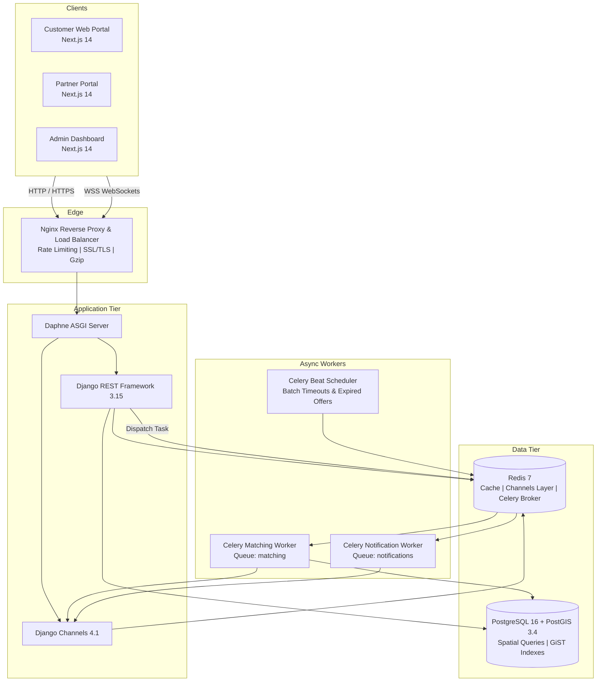
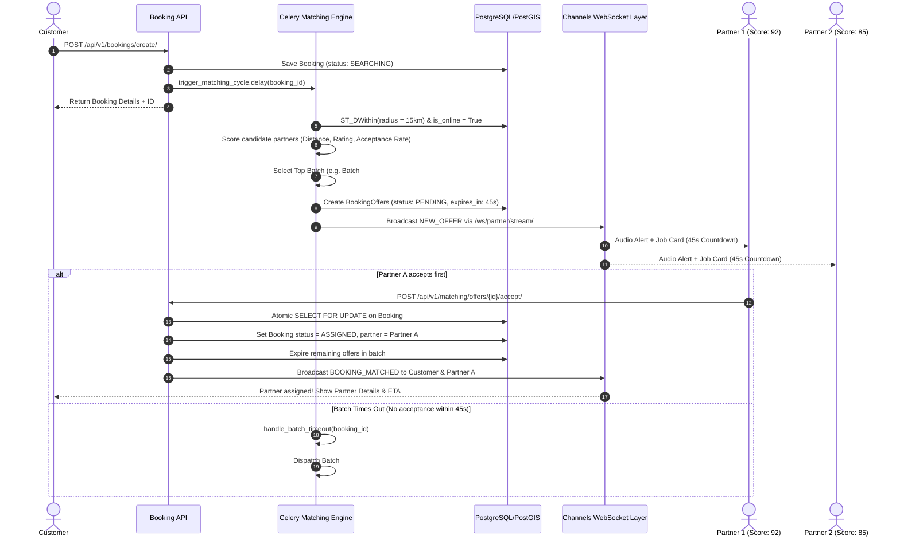
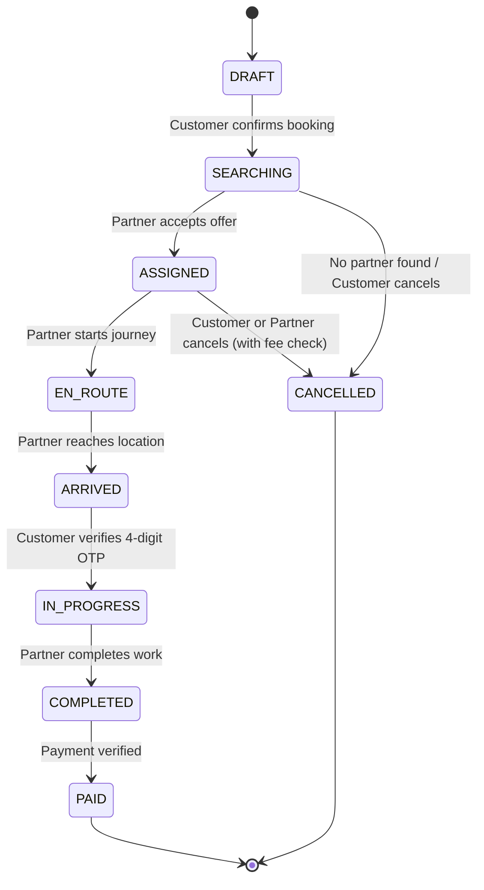

# HomeWorks — System Architecture & Design

This document details the architectural blueprint of HomeWorks, a real-time home services marketplace operating on a Rapido-style match-and-dispatch system.

---

## 1. High-Level System Architecture



---

## 2. Rapido-Style Real-Time Matching Engine

When a customer books an instant or immediate scheduled service:



### Partner Scoring Algorithm
The scoring formula determines the optimal order in which nearby partners are offered jobs:

$$\text{Score} = (W_d \times S_{\text{dist}}) + (W_r \times S_{\text{rating}}) + (W_a \times S_{\text{acceptance}}) + (W_c \times S_{\text{completion}})$$

Where:
- $S_{\text{dist}} = \max(0, 1 - \frac{\text{Distance}}{R_{\max}})$: Closer partners receive higher proximity points.
- $S_{\text{rating}} = \frac{\text{Rating}}{5.0}$: Average customer rating.
- $S_{\text{acceptance}} = \frac{\text{Accepted Offers}}{\text{Total Dispatched Offers}}$: Partner reliability score.
- $S_{\text{completion}} = \frac{\text{Completed Jobs}}{\text{Assigned Jobs}}$: Job finish rate.

---

## 3. Booking Lifecycle State Machine

A booking progresses through the following deterministic states:



### 4-Digit Job Start OTP Security
To prevent fraud or premature billing:
1. Upon matching, a cryptographically random 4-digit OTP is generated and displayed **only to the customer**.
2. When the partner arrives on-site, the partner prompts the customer for the OTP.
3. The partner submits the OTP to `POST /api/v1/bookings/{id}/start/`.
4. Only upon a matching OTP does the booking transition from `ARRIVED` to `IN_PROGRESS` and start the timer.

---

## 4. Database Architecture & PostGIS Spatial Indexing

Geographic queries leverage PostGIS geometries with GiST spatial indexing for low-latency queries:

```sql
-- Nearby partner search query executed by the matching engine
SELECT
    p.id,
    p.user_id,
    ST_Distance(
        loc.location,
        ST_SetSRID(ST_MakePoint(customer_lng, customer_lat), 4326)::geography
    ) / 1000.0 AS distance_km
FROM accounts_partner_profile p
JOIN locations_partner_location loc ON loc.partner_id = p.id
JOIN services_partnerservice ps ON ps.partner_id = p.id
WHERE p.status = 'APPROVED'
  AND p.is_online = TRUE
  AND ps.category_id = :category_id
  AND ps.is_active = TRUE
  AND ST_DWithin(
      loc.location,
      ST_SetSRID(ST_MakePoint(customer_lng, customer_lat), 4326)::geography,
      :radius_meters
  )
ORDER BY distance_km ASC;
```

---

## 5. Security Architecture

1. **Authentication**: Stateless JWT access tokens (1 hour lifetime) + sliding refresh tokens (7 days lifetime) stored securely. Token rotation ensures any compromised refresh token is instantly invalidated.
2. **Access Control**: Role-based access control (RBAC) enforced at viewset and serializer levels.
3. **Audit Trail**: Any administrative action (approving partner KYC, issuing refund, overriding booking status) automatically writes an unalterable `AuditLog` row capturing the actor, target, timestamp, IP, and payload diff.
4. **Denial-of-Service Defense**:
   - Nginx `limit_req_zone` protects API endpoints from burst traffic.
   - Django `RequestSizeLimitMiddleware` terminates requests with bodies exceeding 25MB before reaching serializer memory.
